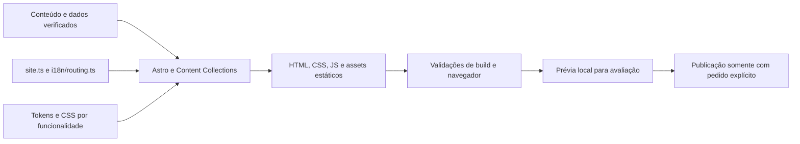

# Decisões e contratos de engenharia

Os contratos orientam a execução incremental. A baseline é histórica; a HUD
foi implementada localmente em [H2-HUD.md](H2-HUD.md), com validação técnica aprovada.
As demais frentes continuam propostas até sua própria evidência de execução.

## Fluxo atual

O navegador usa HTML nativo, scripts pequenos por funcionalidade e as
preferências locais de aparência. Não se cria estado global para substituir
links ou disclosures que já funcionam.

## Registro de decisões

| ADR | Decisão                                                    | Estado e motivo                                                                                 |
| --- | ---------------------------------------------------------- | ----------------------------------------------------------------------------------------------- |
| 01  | Manter Astro, TypeScript, SSG e GitHub Pages               | Aceita; nenhum requisito atual exige servidor ou outro framework                                |
| 02  | Reutilizar tokens e Motion System                          | Aceita; há escala, temas, cancelamento e movimento reduzido funcionais                          |
| 03  | Preservar roteamento e URLs portuguesas                    | Aceita; `sitePath` e o registro i18n já respeitam a base                                        |
| 04  | Quatro grupos lógicos na HUD                               | Implementada localmente em H2; catálogo único e validação técnica aprovada                      |
| 05  | Preferir HTML nativo e navegação convencional              | Aceita; `details`/`summary` quando adequados, sem `role=menu` de aplicativo                     |
| 06  | Preservar lógica de tema                                   | Aceita; a HUD altera composição, não cria outra persistência ou transição                       |
| 07  | Escolher busca após prova com build real                   | Pendente; Pagefind é candidato, não dependência já aprovada ou instalada                        |
| 08  | Manter o manual como fonte oficial versionada              | Aceita; nenhum índice, tradução ou recorte pode contornar o hash                                |
| 09  | Publicar idioma/controle só com destino funcional          | Aceita; ausência de tradução ou busca não se resolve com UI decorativa                          |
| 10  | Reutilizar o harness de navegador existente                | Aceita; CDP e WebDriver já cobrem o necessário; Playwright só se demonstrar uma lacuna concreta |
| 11  | Referência visual aprovada não se atualiza automaticamente | Aceita; candidatos e baselines têm ciclos distintos                                             |
| 12  | Duas instâncias nativas da composição compartilhada da HUD | Implementada em H2; uma exposta por faixa, aparência/CTA únicos, sem mover nós por JavaScript   |

## Contrato da navegação da HUD

O catálogo deve representar identidade estável, chave de mensagem, destino,
grupo e contexto ativo. A camada Astro resolve idioma/base e produz links;
CSS adapta a composição; TypeScript coordena apenas comportamentos.

Não manter uma lista de caminhos por componente ou por idioma. Destinos
internos vêm do registro existente e das entradas de coleções publicadas;
externos vêm de `site.ts`. Âncoras devem ser verificadas no HTML. Um item não
precisa ter descrição ou ícone se não ajudarem a escolher o destino.

O catálogo normativo está em [H1-NAVEGACAO.md](H1-NAVEGACAO.md):
Produto, Documentação, Comunidade e Atualizações, com 16 links e CTA separado
para a release configurada. O documento contém o inventário real, as fontes
de dados, as alternativas descartadas e os oráculos T01–T18. Substitui a lista
de candidatos desta etapa inicial; a implementação local está em H2.

`aria-current=page` identifica o destino exato sem fragmento;
`aria-current=location` identifica a âncora do catálogo quando página/hash
coincidem. Grupo atual, página, localização e expansão são estados distintos,
com indicação além da cor. Capítulos conservam o grupo sem marcar a página
pai como exata; a 404 não tem grupo. Fallback usa idioma e destino reais,
sem equivalência inglesa inventada.

### Contrato de interação

1. Acionar abre; hover sozinho não é obrigatório para descobrir ou usar.
2. Abrir outro painel fecha peers conflitantes, sem ocultar o foco.
3. Escape fecha primeiro o painel interno e devolve foco ao seu controle.
4. Outro Escape pode fechar o painel móvel; não fecha elementos ancestrais
   simultaneamente se um controle interno já tratou o evento.
5. Clicar fora e selecionar um destino fecham os painéis apropriados.
6. Tab e Shift+Tab preservam a ordem lógica, sem armadilha de foco.
7. Resize não deixa um painel desktop inacessível após fechar no mobile.
8. Sem JavaScript, os destinos continuam alcançáveis por HTML nativo.

A decisão H1-D01 usa duas instâncias desktop/mobile da mesma composição,
alimentadas pelo catálogo único, com IDs distintos e apenas uma exposta por
vez. Aparência e CTA têm uma só instância fora do painel móvel. Não mover
controles por JavaScript nem duplicar rádios de tema por conveniência visual.
H1 detalha peers conflitantes, seleção modificada, ordem/retorno de foco,
resize e o limite do fallback nativo sem JS. O fechamento da HUD tem um dono;
a lógica de preferências e transições de tema permanece nos módulos atuais.

H2 comprovou que offsets fixos encobriam âncoras com texto ampliado. A HUD
usa container query de 54rem internos e altura observada, documentadas em
[H2-HUD.md](H2-HUD.md); CSS é a fonte da composição exposta. Investigar o empilhamento de
sticky, View Transitions e backdrop antes de alterar transparência. Não
animar blur ou posição ao rolar.

## Contrato da busca estática

C0 deve testar um índice construído do `dist/` real. O índice precisa
identificar título, trecho, URL/âncora, idioma e tipo de conteúdo; versão
quando relevante. Não se cria outra fonte editorial para alimentar a busca.

Indexar conteúdo público e verificado; excluir 404, drafts, testes, páginas
vazias, duplicatas de navegação e traduções não revisadas. O manual mantém
origem e versão e deve ser encontrável por suas seções reais.

O resultado de C0 deve registrar:

- Pacote/versão, forma de instalação e justificativa da dependência.
- Ordem do build, quantidade de páginas/seções e bytes do índice/runtime.
- Consultas reais, relevância e URLs com `/KineinSite/`.
- Necessidades de CSP, workers/WASM e carregamento sob demanda.
- Idiomas, filtros e comportamento em falha/offline.

Não relaxar a CSP global para acomodar um indexador. Se a solução não
funcionar com o modelo de segurança aceito, documentar o impedimento e
comparar alternativas. Não instalar uma solução concorrente automaticamente.

Após a decisão, o fluxo previsto é: build HTML → índice → verificações do
artefato e dos links → teste do índice real. A busca deve operar só com os
arquivos estáticos do site. UI sem backend, sem consultas enviadas a terceiros.

Estados: inicial, carregando, resultados, vazio e erro. Respostas antigas
não podem substituir uma consulta mais recente. Renderizar conteúdo com
APIs seguras; não injetar HTML não sanitizado retornado por um índice.
Modal, se adotado, precisa de foco inicial, Escape, retorno de foco e
navegação de resultados. Ctrl/Cmd+K só existe quando a busca funciona e não
interfere com edição ou composição de texto.

## Contrato de conteúdo e internacionalização

Reutilizar `src/i18n/`. O catálogo tipado contém UI; Markdown continua sendo
conteúdo editorial. Não criar um segundo roteador nem migrar todos os textos
portugueses de diretório sem necessidade.

Para traduções técnicas, avaliar metadados mínimos: identidade estável da
página, idioma, referência à fonte, revisão da fonte traduzida e estado de
revisão. Adicionar apenas o que não possa ser derivado do schema atual.
A relação entre traduções não depende do título.

O manual original continua intacto. Traduções ou apresentações derivadas
devem declarar sua origem e revisão, sem se tornar outra fonte oficial
independente. Não marcar uma tradução como atual se sua fonte mudou.

Estados editoriais propostos: não iniciada, em revisão, verificada e
desatualizada. Estado editorial é diferente de disponibilidade de uma rota.
Somente conteúdo completo e revisado entra no conjunto de destinos oferecidos.

| Termo                                 | Orientação inicial                                                              |
| ------------------------------------- | ------------------------------------------------------------------------------- |
| Build, debug, toolchain, firmware     | Preservar uso técnico natural; não traduzir nomes de comandos                   |
| Target                                | Alvo no texto explicativo; preservar nomes reais da interface e configuração    |
| Workspace / project                   | Workspace/área de trabalho e projeto conforme contexto; não confundir conceitos |
| Compiler / debugger                   | Compilador/depurador na explicação, nomes de ferramentas intactos               |
| Arquivos, flags, APIs e botões da IDE | Preservar grafia real e versão da interface documentada                         |

Este glossário inicial precisa ser conferido nos textos da primeira tradução;
não autoriza traduzir automaticamente o manual.

Seletor só oferece equivalências existentes. Fallback deve identificar o
idioma de destino e não redirecionar silenciosamente para outra página.
`lang`, canonical, Open Graph e alternates acompanham o conteúdo real.
Sitemap inclui apenas URLs públicas e indexáveis do artefato gerado.

## Contrato de versão e download

`publicVersion` e `publicTag` continuam sendo a fonte local da versão
apresentada. Atualização exige conferência da release efetiva, assets,
plataforma, arquitetura, notas e manual correspondente. Commits recentes
da IDE não equivalem a uma release.

Não copiar o guia de instalação para uma nova página. Se uma página de
download for justificada, ela deve conectar release, requisitos, verificação,
notas e primeiro projeto. Checksums só são chamados de oficiais quando
publicados na fonte oficial para o mesmo arquivo.

## Limites transversais

### Riscos da implementação seguinte

São condições a testar ao mudar o código, não defeitos já atribuídos à baseline.

| Risco                                           | Gatilho                                             | Controle e evidência                                                                       |
| ----------------------------------------------- | --------------------------------------------------- | ------------------------------------------------------------------------------------------ |
| Foco perdido ou fechamento duplo                | Introduzir dropdown dentro do painel móvel          | Casos H-02, Escape em camadas, clique fora e resize antes de polimento visual              |
| Âncora ou conteúdo encoberto                    | Alterar geometria, sticky ou empilhamento da HUD    | Medir altura e testar âncoras nos consumidores; só ajustar offsets quando necessário       |
| Índice incompatível ou excessivo                | Adotar busca e novos assets de execução             | C0 com build real, bytes, CSP e base; nenhuma dependência antes da decisão                 |
| Tradução publicada sem corresponder à fonte     | Criar rotas inglesas ou atualizar conteúdo original | Identidade/revisão e estado editorial em F0; teste de equivalência e revisão técnica em F1 |
| Mudança visual acidental aceita como referência | Atualizar capturas junto de CSS compartilhado       | Candidatos separados, diff investigado e avaliação explícita do mantenedor                 |

Se um risco se materializar, registrar o caso reproduzido e a decisão no
relatório do pacote. Não transformar toda possibilidade em uma refatoração preventiva.

### Restrições preservadas

Sem framework de UI adicional, servidor próprio, analytics, fontes remotas,
tokens privados no cliente ou bibliotecas apenas para animações simples.
Não alterar os intervalos, paginação, cache e limites da integração GitHub
sem evidência. Nenhuma fase remove verificações ou cria exceções arquiteturais
para facilitar o próprio desenvolvimento.
